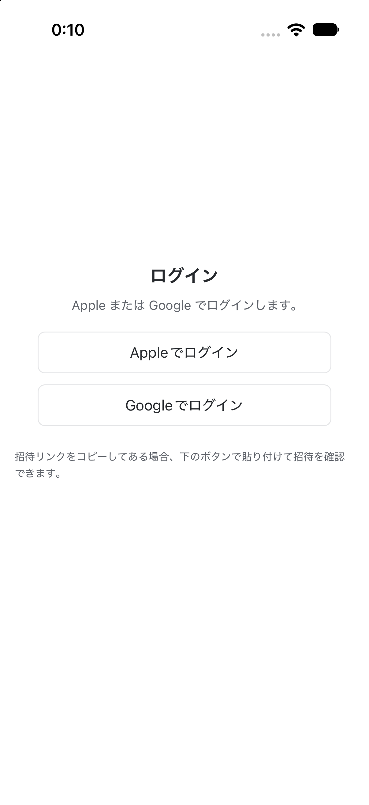
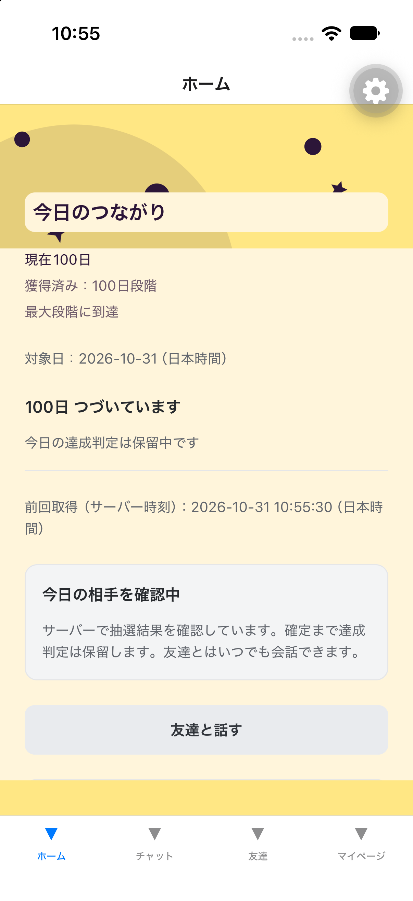
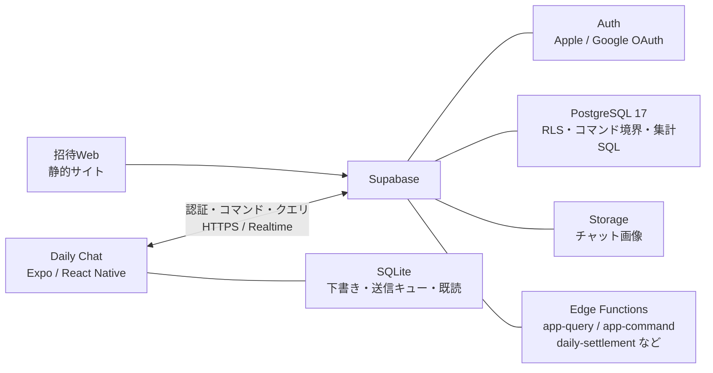

# Daily Chat

**友達との「毎日の会話のきっかけ」を作る、iOS / Android 向けのチャットアプリ。**

[MBC U-20 NEXT PROGRAMMING CONTEST 2026](https://www.mbc.co.jp/u20nextprocon/) アプリ（ソフトウェア）部門 応募作品。

<p align="center">
  
  
</p>

<p align="center"><sub>開発ビルドでの表示例（左: ログイン、右: 100日段階のホーム）</sub></p>

## Daily Chatとは

連絡先は知っているのに、最近話していない友達はいませんか。
話したくないわけではない。でも、何をきっかけに連絡すればいいのか迷ってしまう。

Daily Chat は、すでに友達関係にある2人の間に、負担の少ない会話のきっかけを毎日1回だけ用意するアプリです。知らない人と出会うためのアプリではありません。

毎日サーバーが友達の中から送信相手（Send Target）を1人、返信が必要な相手（Reply Target）を決めます。ユーザーは送信相手にメッセージを送り、届いた相手には返信します。これを続けると Streak（連続達成日数）が伸び、2人の会話が積み重なるほどチャット画面の見た目が 1日・7日・30日・60日・100日 の節目で成長します。

「毎日続けなければ」と追い込むのではなく、会話の累計は途切れても残る設計です。大きな用事がなくても、近況をひとこと送る。そのきっかけをアプリから提供します。

## 主な機能

- **毎日の相手を決める** — 04:00 JST に切り替わる送信相手・返信相手の割り当て
- **友達とつながる** — User ID 検索、友達申請・承認、招待リンク／QRコード、ディープリンク
- **非同期チャット** — テキスト（10,000書記素まで）と画像（最大4枚、1枚10MBまで）
- **オフライン対応** — 下書き・添付・送信待ちを端末に保存し、再接続・アプリ復帰・バックグラウンドで同期
- **送信状態の区別** — 送信待ち／送信中／結果確認中／完了／確認が必要を混同しない
- **既読と未読** — 既読管理、未読バッジ、アプリ内の新着表示
- **関係の成長** — Streak と Chat Growth（2人の累計会話日数）の記録と節目の演出
- **アクセシビリティ** — ライト／ダークテーマ、文字サイズ拡大、読み上げ、動きの軽減
- **タブレット対応** — 論理幅900以上で2列レイアウト、狭い画面では1列へ

## 技術構成

| 層 | 使用技術 |
| --- | --- |
| モバイルアプリ | [Expo SDK 58](https://expo.dev/) / React Native 0.88 / React 19 / TypeScript / Expo Router |
| 端末内保存 | expo-sqlite（下書き、送信キュー、既読状態） |
| バックエンド | [Supabase](https://supabase.com/)（PostgreSQL 17、Auth、Storage、Realtime） |
| サーバー処理 | Supabase Edge Functions（Deno / TypeScript） |
| 招待Web | 静的 HTML / CSS / JavaScript |
| テスト | Jest / Testing Library / pgTAP / Deno Test / Node Test Runner |

## アーキテクチャ



アプリは Expo / React Native の単一コードベースで iOS と Android に対応します。端末内の SQLite は下書き・送信待ち・既読のキャッシュを持ち、サーバー側の PostgreSQL が本人性・受付時刻・達成・成長を確定します。リアルタイム通知は更新の合図として使い、履歴の正本にはしません。初回表示・再接続・アプリ復帰時は認証付きクエリから再取得します。

## クイックスタート

### 必要なもの

- Node.js 22.13+ / 24.3+ / 26以降（Expo SDK 58 の要件）
- Docker（ローカル Supabase 用）
- Supabase CLI（`npx supabase` で実行）
- iOS: macOS・Xcode・シミュレータまたは開発用実機
- Android: Android SDK・JDK 17・接続デバイスまたは AVD

### 1. バックエンドを起動する

```sh
npx supabase start
npx supabase migration up --local
```

Edge Functions を使う場合は、別のターミナルで起動したままにします。

```sh
npx supabase functions serve
```

### 2. アプリの環境変数を用意する

```sh
cp app/.env.example app/.env
```

`npx supabase status` の API URL と anon key を `app/.env` に設定します。

```dotenv
EXPO_PUBLIC_SUPABASE_URL=http://127.0.0.1:54321
EXPO_PUBLIC_SUPABASE_ANON_KEY=<supabase status の anon key>
```

招待機能まで試す場合のみ、HTTPS の origin を設定します。

```dotenv
EXPO_PUBLIC_INVITE_ORIGIN=https://invite.example.com
```

### 3. アプリを起動する

```sh
npm --prefix app ci
npm --prefix app run ios       # または npm --prefix app run android
```

Expo Go ではなく、上記でビルドした開発クライアントを開きます。ネイティブ依存を変更した場合は、`npm run ios` / `npm run android` で開発ビルドを作り直してください。

> **ログインについて**
>
> ログインは Apple / Google OAuth のみです。ローカルでログインまで試すには、Google Cloud / Apple Developer の資格情報を用意し、`supabase/config.toml` とルートの `.env` に設定する必要があります。資格情報がない場合でも、自動テストと提出動画で動作を確認できます。

実機から接続する場合、`127.0.0.1` は端末自身を指すため、PC の LAN アドレスに置き換える必要があります。詳しい手順は [DEVELOPMENT.md](DEVELOPMENT.md) を参照してください。

## 環境変数

実際の値はコミットしません。テンプレートだけをリポジトリに置いています。

| ファイル | 用途 |
| --- | --- |
| [`app/.env.example`](app/.env.example) | アプリの Supabase URL / anon key / 招待 origin |
| [`app/env/supabase.local.env.example`](app/env/supabase.local.env.example) | ローカル Supabase 向けのテンプレート |
| [`app/env/supabase.remote.env.example`](app/env/supabase.remote.env.example) | リモート Supabase 向けのテンプレート |
| [`.env.example`](.env.example) | ルートの Supabase CLI 用（Google OAuth secret / redirect URI） |

`EXPO_PUBLIC_` 接頭辞の値はアプリのバンドルに平文で入るため、クライアントシークレットなどの秘密値を入れないでください。`service_role` key は Edge Functions の実行環境だけに置き、アプリには渡しません。

## テスト

```sh
# 型検査
npm --prefix app run typecheck

# 画面・状態・SQLite のテスト（実バックエンドを使う journey を除く）
npm --prefix app test -- --runInBand --testPathIgnorePatterns home-chat-journey.test.tsx

# データベース（RLS・制約・集計）
npx supabase test db

# Edge Functions
npx deno test --allow-env --allow-net --config supabase/functions/deno.json supabase/functions/tests

# 実バックエンドを通す統合テスト（Docker + ローカル Supabase）
node scripts/test-chat-backend.mjs --suite all
```

統合テストは実際の Auth ユーザーと fixture を作成・削除します。通常の開発 DB と同時に実行せず、手順と後片付けは [DEVELOPMENT.md](DEVELOPMENT.md) の「5. 動作確認と自動テスト」を参照してください。

## ディレクトリ構成

```text
.
├── app/                      Expo / React Native アプリ本体
│   ├── src/
│   │   ├── app/              画面（Expo Router）
│   │   ├── auth/             ログイン・セッション
│   │   ├── daily/            日次の割り当て
│   │   ├── messages/         チャット
│   │   ├── sync/             オフライン送信キューと同期
│   │   ├── appearance/       Streak・Chat Growth の見た目
│   │   ├── invitations/      招待リンク・QR
│   │   └── storage/          SQLite
│   ├── __tests__/            画面・結合テスト
│   └── assets/               アイコンなどの素材
├── supabase/
│   ├── migrations/           スキーマ、RLS、コマンド境界、集計SQL
│   ├── functions/            Edge Functions（Deno / TypeScript）
│   └── config.toml           ローカル Supabase 設定
├── invite-web/               招待ランディング（静的サイトのソース）
├── scripts/                  ビルド・検証・テスト用スクリプト
├── docs/                     設計・運用手順・検証記録
├── CONTEXT.md                用語集
├── DEVELOPMENT.md            開発・検証の詳細
└── SUBMISSION.md             大会提出用の説明
```

`app/ios` と `app/android` は Expo の prebuild で生成されるため、リポジトリには含めていません。`npx expo prebuild` で再生成できます。

## 設計のポイント

- **サーバーを正とするコマンド境界** — クライアントは送信・既読・設定変更を Edge Function のコマンドとして送り、SQL 側で本人性・関係世代・冪等性・検証記録を確定します。クライアントの自己申告をそのまま信用しません。
- **オフラインでも壊れない送信** — 送信は「入力 → 予約 → 送信 → 確定」の状態を持ち、再送しても同じ操作 ID でサーバーが再生します。結果が不明な場合は成功扱いにせず、「確認が必要」としてユーザーに区別して見せます。
- **日付の境界を固定** — 日次の切り替えは端末時計ではなくサーバーの 04:00 JST で行い、抽選は 04:05 より前に確定させます。送信を予約しただけでは達成になりません。
- **表示と記録の分離** — Streak と Chat Growth の見た目は、サーバーに記録された事実から導出します。獲得済みの見た目は途切れても減らさず、開発用プレビューは `__DEV__` に限定しています。
- **Unicode の書記素単位** — 本文の 10,000 文字はコードポイント数ではなく、Unicode 17.0 / UAX #29 の拡張書記素クラスタで数えます。iOS・Android・Deno で同じ判定になるよう、環境依存の `Intl` や正規表現を使いません。

## セキュリティとプライバシー

- 実キー・パスワード・OAuth クライアントシークレットはリポジトリに含めていません。`.env` は git 管理外です。
- Supabase のテーブルは RLS を有効にし、クライアントからの直接書き込みを剥奪しています。更新は認証付きの Edge Functions / SQL 関数に集約しています。
- `service_role` key はサーバー側だけで使い、アプリには渡しません。
- テスト用のメールアドレスはすべて合成データです。実在の個人情報は含めていません。
- Google OAuth のクライアント ID は公開情報ですが、クライアントシークレットは環境変数から供給します。

## ドキュメント

| ドキュメント | 内容 |
| --- | --- |
| [DEVELOPMENT.md](DEVELOPMENT.md) | 起動、二者での手動確認、自動テスト、トラブル対処の詳細 |
| [CONTEXT.md](CONTEXT.md) | Friend / Chat / Chat Growth / Streak などの用語定義 |
| [SUBMISSION.md](SUBMISSION.md) | 大会提出用の作品説明・起動方法・メインコードの解説 |
| [docs/README.md](docs/README.md) | ドキュメント全体の索引 |
| [docs/operations/](docs/operations/) | 日次ジョブ、通知、招待ドメインなどの運用手順 |
| [docs/testing/](docs/testing/) | 実機・自動テストの検証記録とスクリーンショット |
| [docs/sdd/specs/](docs/sdd/specs/) | 設計仕様（アーキテクチャ、データ、順序保証） |
| [docs/sdd/plans/](docs/sdd/plans/) | 実装計画とタスク分割 |

## 大会への応募

- **大会**: MBC U-20 NEXT PROGRAMMING CONTEST 2026
- **部門**: アプリ（ソフトウェア）部門
- **提出物**: 作品説明動画（5分以内）、作品本体のZIP、メインコード単体、本リポジトリ
- 作品説明動画は大会提出用に別途作成しています。動画の制作資料はこのリポジトリには含めていません。
- 開発における生成AIの利用有無・モデル名・利用範囲は、応募フォームの設問に記載しています。

## ライセンス

アプリの雛形に由来するライセンスは [app/LICENSE](app/LICENSE) を参照してください。
本リポジトリのコードは、コンテストの審査および閲覧のために公開しています。特に明記がない限り、著作権は応募者に帰属します。

## 謝辞

- [Expo](https://expo.dev/) / [React Native](https://reactnative.dev/) / [Supabase](https://supabase.com/)
- 作品説明動画の音声: VOICEVOX:四国めたん
